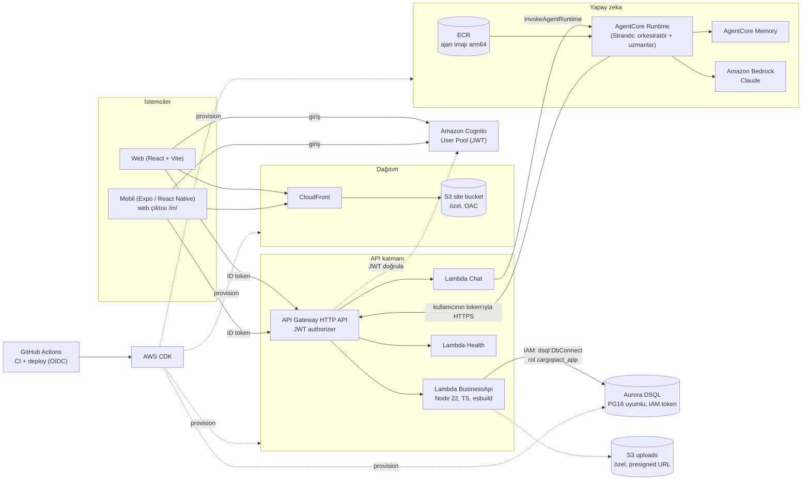
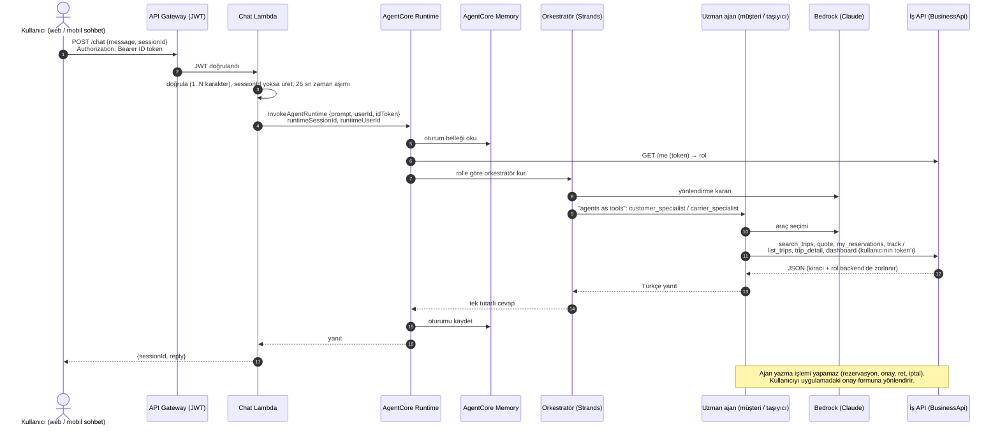

# CargoPact – Mimari

Bölge: `us-east-1`. IaC: AWS CDK (`infra/lib/*.ts`, yığınlar: Auth, Data, Agents, Api, Web). Ayrıntılı tasarım: `.kiro/specs/platform-foundation/design.md`.

> Durum notu: Diyagramlar hedef mimariyi gösterir. Ajan Runtime'ı (`CfnRuntime`) yalnızca imaj etiketi verilince (`-c agentImageTag=…`) oluşur; canlıda yayında olup olmadığı **doğrulanacak**. İş API'sindeki sefer/rezervasyon uçlarının canlı durumu da sunum öncesi `docs/REVIEW_CHECKLIST.md` ile doğrulanır.

## (a) Bileşen diyagramı



**Açıklama**
- **İstemciler:** web ve mobil aynı API'yi ve aynı `packages/contracts` tiplerini kullanır. Mobil, Expo web çıktısı olarak CloudFront'ta `/m/` altında yayınlanır.
- **Kimlik:** Cognito ID token'ı API Gateway'de doğrulanır. Lambda, kiracı ve rolü JWT `sub` üzerinden `users/memberships` tablosundan türetir; istemciden gelen kiracı bilgisine güvenilmez.
- **Veri:** Lambda, DSQL'e parolasız, IAM token ile bağlanır. Lambda rolü `cargopact-api-lambda`, DSQL rolü `cargopact_app` ile eşlenir.
- **Ajanlar:** Sohbet Lambda'sı çağıranın token'ını Runtime'a iletir. Ajan araçları iş API'sini bu token'la çağırır; yetki ve kiracı kontrolü backend'de kalır.
- **Dosyalar:** özel S3 bucket'ı; erişim presigned URL ile.

## (b) Sıra diyagramı: rezervasyon → onay (kapasite sıcak satırı + idempotency)

Neden tek sıcak satır? Aurora DSQL snapshot isolation ve iyimser eşzamanlılık (OCC) kullanır. Yalnızca **aynı satıra** yazan işlemler çakışır; farklı satır ekleyen iki işlem birbirini görmez (write skew). Bu yüzden "kapasite aşılmaz" değişmezini sefer başına tek satırla (`trip_capacity`) koruruz. İkinci commit `40001` hatası alır ve yeniden dener; yeniden denemede güncel sayaç görüldüğü için kapasite yoksa `CAPACITY_EXCEEDED` (409) döner. Aynı satırda `SELECT … FOR UPDATE` yalnızca okumayı yazma kümesine alır; çakışmayı çözen OCC'dir.

```mermaid
sequenceDiagram
  autonumber
  actor C as Müşteri (web/mobil)
  participant G as API Gateway (JWT)
  participant L as BusinessApi Lambda
  participant D as Aurora DSQL
  actor P as Taşıyıcı planlamacı

  C->>G: POST /customer/reservations<br/>Idempotency-Key: K1
  G->>L: JWT doğrulandı (sub)
  L->>D: BEGIN
  L->>D: idempotency_keys: INSERT ... ON CONFLICT (K1)
  alt K1 daha önce işlendi (aynı gövde)
    D-->>L: kayıtlı yanıt
    L-->>C: aynı yanıt (yeni mutasyon yok)
  else K1 var, gövde farklı
    L-->>C: 422 IDEMPOTENCY_MISMATCH
  else yeni istek
    L->>L: tenant = JWT üyeliği, T−3 sınırı, uygunluk, dinamik fiyat (sunucuda)
    L->>D: SELECT trip_capacity FOR UPDATE (sefer başına tek sıcak satır)
    L->>D: held_* += (palet, kg, m³); INSERT reservation (TASIYICI_ONAYI_BEKLIYOR), ledger AUTHORIZED
    L->>D: COMMIT
    alt eşzamanlı başka işlem aynı satırı önce yazdı
      D-->>L: 40001 (OC000)
      L->>D: yeniden dene (geri çekilme + jitter), güncel sayaçla yeniden hesapla
    end
    L-->>C: 201 Reservation (BV-…, bloke)
  end

  P->>G: POST /carrier/reservations/{id}/decision (approve) Idempotency-Key: K2
  G->>L: istek
  L->>D: BEGIN; SELECT trip_capacity FOR UPDATE
  L->>L: uygunluğu yeniden kontrol (palet + brüt kg + m³ + ürün + zaman)
  L->>D: held_* -= x; confirmed_* += x
  L->>D: order_counters: yıllık sayaçtan CP-2026-NNNNNN, palet kodları
  L->>D: ledger CAPTURED; reservation_events; audit_log
  L->>D: COMMIT (40001 olursa yeniden dene)
  L-->>P: CarrierReservation (ONAYLI, sipariş no)
  Note over L,D: Aynı onayın tekrarı aynı sipariş numarasını döner.<br/>Ret/iptal/süre aşımı kapasiteyi bir kez iade eder.
```

**Açıklama**
- **Idempotency:** Her yazma isteği `Idempotency-Key` ister. Aynı anahtar ve gövde aynı yanıtı döner, farklı gövde 422.
- **Sıcak satır:** `trip_capacity(trip_id PK)` satırı held/confirmed/loaded sayaçlarını taşır. Doğrulama: DSQL'de 6 eşzamanlı istekten 1 kazanan (`npm run test:integration`).
- **Sipariş numarası:** DSQL'de sekans yalnız açık `CACHE` ile çalıştığı için yıllık sayaç tablosu (`order_counters`) kullanılır.
- **Mevcut durum:** `trip_capacity`, `reservations`, `ledger_entries`, `order_counters` migrasyonları repoda var (0030–0042). İş mantığının uç noktalarının canlı durumu **doğrulanacak**.

## (c) Sohbet çağrı yolu



**Açıklama**
- **Kimlik taşıma:** Chat Lambda ham ID token'ı Runtime'a iletir (loglanmaz). Ajan araçları iş API'sini bu token'la çağırır. Başka firmanın verisi, kullanıcının kendi yetkisiyle zaten görünmez.
- **Rol:** Ajan rolü `GET /me` ile backend'den öğrenir; prompt veya kullanıcı girdisinden seçilemez.
- **Dayanıklılık:** Runtime yoksa Lambda 503, zaman aşımında/hatada kullanıcıya düzgün bir Türkçe mesaj döner (200).
- **Alternatif kanal:** Amazon Q Business bu hesapta `AccessDenied`; sohbet bu nedenle kendi arayüzümüz + AgentCore üzerindendir.
- **Knowledge Base:** Taşıyıcıya özel Bedrock Knowledge Base planlanan bir bileşendir; canlı kurulum durumu **doğrulanacak**. Kurulu değilse öncelik/gelmeme kuralı `carrier_rules` aracından gelir.

## Güvenlik ve kiracı sınırı (özet)

- API Gateway'de JWT zorunlu (`/health` hariç). CORS demo için `*`.
- Kiracı kimliği JWT üyeliğinden türetilir. Repository fonksiyonları `tenantId` parametresini zorunlu alır. Kiracı sızıntı testleri smoke ve birim testlerinde.
- DSQL erişimi IAM ile en az yetki: Lambda rolü yalnız `dsql:DbConnect`. Parola yok.
- Para `bigint` kuruş, zaman `timestamptz` UTC; ekranda `Europe/Istanbul`.
