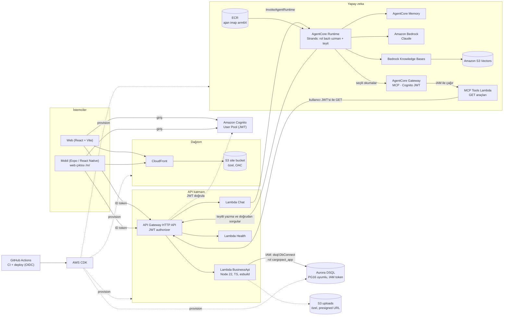
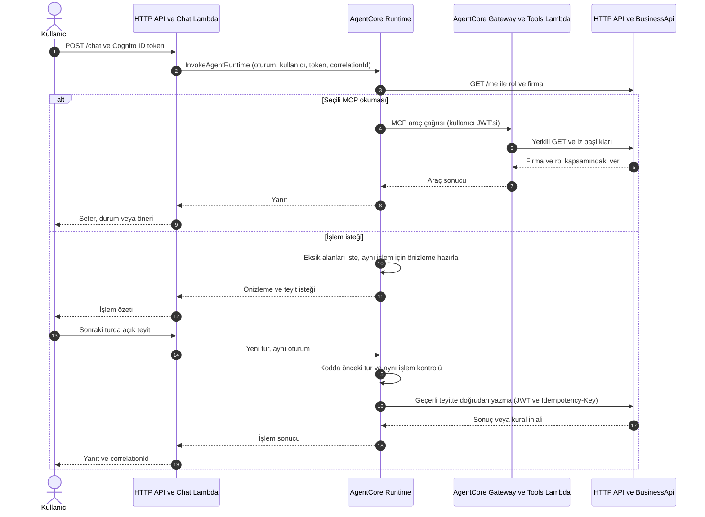

# CargoPact – Mimari

Bölge `us-east-1`. AWS CDK yığınları Auth, Data, Gateway, Agents, Api ve Web. Çizim ve servis tablosu [Draw.io](CargoPact_AWS_Mimarisi.drawio) ve [AWS servisleri](AWS_SERVISLERI.md) belgelerinde.

> Diyagramlar güncel kaynak kodu (`81ebd14`) gösterir. CDK Runtime imaj etiketi `assist-1`. Aynı commit mesajı asistan smoke sonucunu 12/12 olarak bildiriyor. Canlı AWS sürümü ve TMS/WMS uçtan uca akışı bu güncellemede yeniden doğrulanmadı.

## (a) Bileşen diyagramı



**Açıklama**
- **İstemciler:** web ve mobil aynı API'yi ve aynı `packages/contracts` tiplerini kullanır. Mobil, Expo web çıktısı olarak CloudFront'ta `/m/` altında yayınlanır.
- **Kimlik:** Cognito ID token'ı API Gateway'de doğrulanır. Lambda, kiracı ve rolü JWT `sub` üzerinden `users/memberships` tablosundan türetir; istemciden gelen kiracı bilgisine güvenilmez.
- **Veri:** Lambda, DSQL'e parolasız, IAM token ile bağlanır. Lambda rolü `cargopact-api-lambda`, DSQL rolü `cargopact_app` ile eşlenir.
- **Ajan:** Chat Lambda çağıranın token’ını ve iz kimliğini Runtime’a iletir. Runtime, `/me` yanıtından rolü ve firmayı alıp müşteri veya taşıyıcı uzmanını kodla seçer. MCP seçili GET araçlarını sunar. Teyitli yazılar aynı iş API’sine MCP’ye uğramadan gider.
- **Dosyalar:** özel S3 bucket'ı; erişim presigned URL ile.

## (b) Sıra diyagramı: rezervasyon → onay (kapasite sıcak satırı + idempotency)

Neden tek sıcak satır? Aurora DSQL snapshot isolation ve iyimser eşzamanlılık (OCC) kullanır. Yalnızca **aynı satıra** yazan işlemler çakışır; farklı satır ekleyen iki işlem birbirini görmez (write skew). Bu yüzden "kapasite aşılmaz" değişmezini sefer başına tek satırla (`trip_capacity`) koruruz. İkinci commit `40001` hatası alır ve yeniden dener; yeniden denemede güncel sayaç görüldüğü için kapasite yoksa `CAPACITY_EXCEEDED` (409) döner. Aynı satırda `SELECT … FOR UPDATE` yalnızca okumayı yazma kümesine alır; çakışmayı çözen OCC'dir.

```mermaid
sequenceDiagram
  autonumber
  actor C as Müşteri (web/mobil)
  participant G as API Gateway (JWT)
  participant L as BusinessApi Lambda
  participant D as Aurora DSQL
  actor P as Taşıyıcı planlamacı

  C->>G: POST /customer/reservations<br/>Idempotency-Key: K1
  G->>L: JWT doğrulandı (sub)
  L->>D: BEGIN
  L->>D: idempotency_keys: INSERT ... ON CONFLICT (K1)
  alt K1 daha önce işlendi (aynı gövde)
    D-->>L: kayıtlı yanıt
    L-->>C: aynı yanıt (yeni mutasyon yok)
  else K1 var, gövde farklı
    L-->>C: 422 IDEMPOTENCY_MISMATCH
  else yeni istek
    L->>L: tenant = JWT üyeliği, T−3 sınırı, uygunluk, dinamik fiyat (sunucuda)
    L->>D: SELECT trip_capacity FOR UPDATE (sefer başına tek sıcak satır)
    L->>D: held_* += (palet, kg, m³); INSERT reservation (TASIYICI_ONAYI_BEKLIYOR), ledger AUTHORIZED
    L->>D: COMMIT
    alt eşzamanlı başka işlem aynı satırı önce yazdı
      D-->>L: 40001 (OC000)
      L->>D: yeniden dene (geri çekilme + jitter), güncel sayaçla yeniden hesapla
    end
    L-->>C: 201 Reservation (BV-…, bloke)
  end

  P->>G: POST /carrier/reservations/{id}/decision (approve) Idempotency-Key: K2
  G->>L: istek
  L->>D: BEGIN; SELECT trip_capacity FOR UPDATE
  L->>L: uygunluğu yeniden kontrol (palet + brüt kg + m³ + ürün + zaman)
  L->>D: held_* -= x; confirmed_* += x
  L->>D: order_counters: yıllık sayaçtan CP-2026-NNNNNN, palet kodları
  L->>D: ledger CAPTURED; reservation_events; audit_log
  L->>D: COMMIT (40001 olursa yeniden dene)
  L-->>P: CarrierReservation (ONAYLI, sipariş no)
  Note over L,D: Aynı onayın tekrarı aynı sipariş numarasını döner.<br/>Ret/iptal/süre aşımı kapasiteyi bir kez iade eder.
```

**Açıklama**
- **Idempotency:** Rezervasyon ve taşıyıcı onayı gibi bu mekanizmayı kullanan uçlarda aynı `Idempotency-Key` ve gövde aynı yanıtı döndürür, farklı gövde 422 döner.
- **Sıcak satır:** `trip_capacity(trip_id PK)` satırı held/confirmed/loaded sayaçlarını taşır. Doğrulama: DSQL'de 6 eşzamanlı istekten 1 kazanan (`npm run test:integration`).
- **Sipariş numarası:** DSQL'de sekans yalnız açık `CACHE` ile çalıştığı için yıllık sayaç tablosu (`order_counters`) kullanılır.
- **Mevcut durum:** `trip_capacity`, `reservations`, `ledger_entries`, `order_counters` migrasyonları repoda var (0030–0042). İş mantığının uç noktalarının canlı durumu **doğrulanacak**.

## (c) Sohbet çağrı yolu ve teyitli işlemler



**Açıklama**
- **Teyit:** `writes.py` aynı oturumda, aynı parametrelerle ve önceki turda yapılmış önizlemeyi arar. Yalnız sonraki turdaki açık kullanıcı teyidi iş işlemini başlatır. Bekleyen teyit Runtime belleğinde 30 dakika geçerlidir ve kullanılınca kaldırılır. AgentCore Memory sohbet bağlamı içindir, bekleyen teyit deposu değildir.
- **Yazma kapsamı:** Müşteri rezervasyon talebi açar, iptal eder ve alıcıları günceller. Yetkili taşıyıcı onay/ret, depo olayı, sefer açma/yayınlama ve istisna kapatma işlemleri yapabilir. Müşteri teyidi taşıyıcı onayı yerine geçmez.
- **İş kuralları ve iz:** BusinessApi çağıranın JWT’siyle rolü, firmayı ve ilgili iş kurallarını yeniden denetler. Ajan yazma isteklerine oturum ve işlemden türetilen `Idempotency-Key` ekler. `correlationId` sohbet ve araç çağrısını birbirine bağlar. Kart bilgisi istenmez, ödeme simüledir.
- **Okumalar:** AgentCore Gateway’de sekiz GET aracı kayıtlıdır. Gateway çağrısı teknik hata verirse ilgili okumalar doğrudan iş API’sine dönebilir. Teklif önizlemesi de doğrudan API’ye gider ve teklif KPI kaydı oluşturabilir. Taşıyıcı kural sorgusunda Bedrock Knowledge Bases firma filtresi kullanır.
- **Kanal:** Web asistanı çekmece olarak açılır. Web ve mobil aynı `/chat` ucunu kullanır. Amazon Q Business bu hesapta `AccessDenied` nedeniyle demo dışında kalır.

## Güvenlik ve kiracı sınırı (özet)

- API Gateway'de JWT zorunlu (`/health` hariç). CORS demo için `*`.
- Kiracı kimliği JWT üyeliğinden türetilir. Repository fonksiyonları `tenantId` parametresini zorunlu alır. Kiracı sızıntı testleri smoke ve birim testlerinde.
- DSQL erişimi IAM ile en az yetki: Lambda rolü yalnız `dsql:DbConnect`. Parola yok.
- Para `bigint` kuruş, zaman `timestamptz` UTC; ekranda `Europe/Istanbul`.
