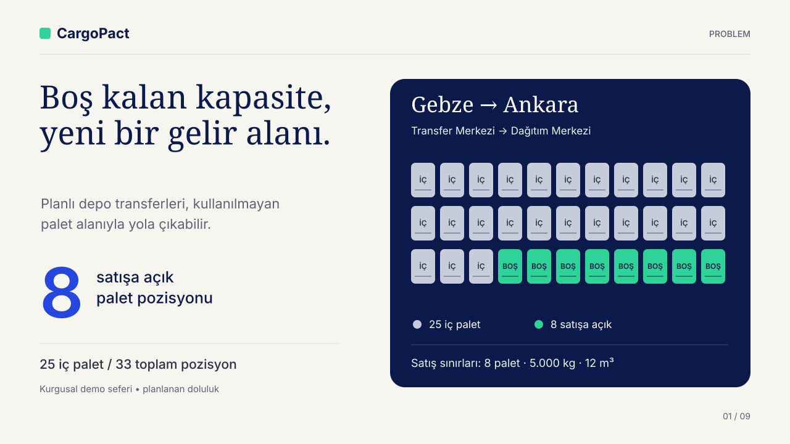
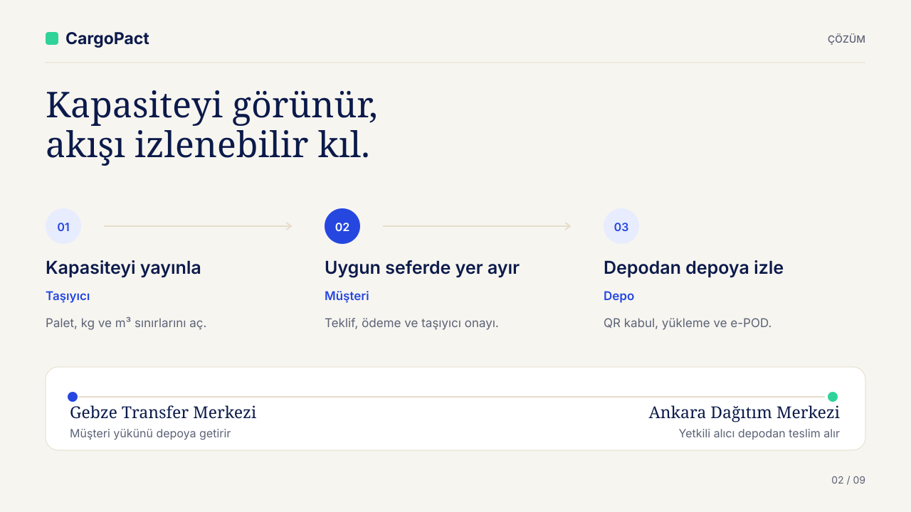
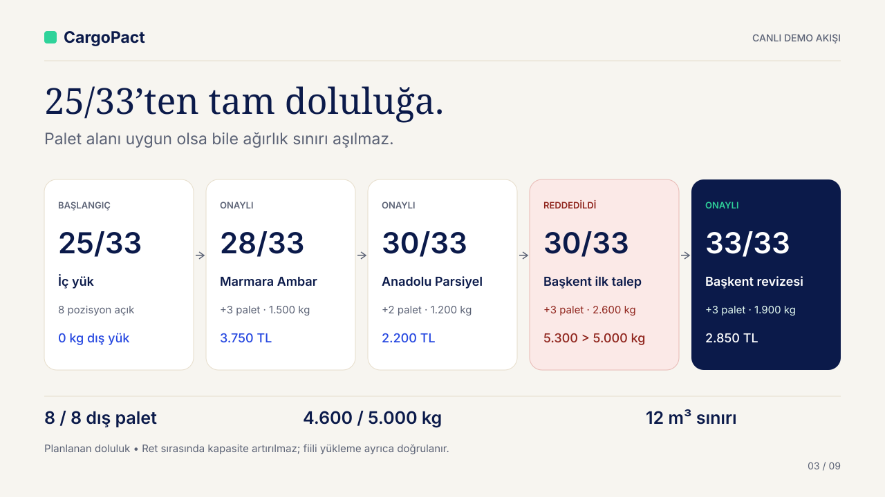
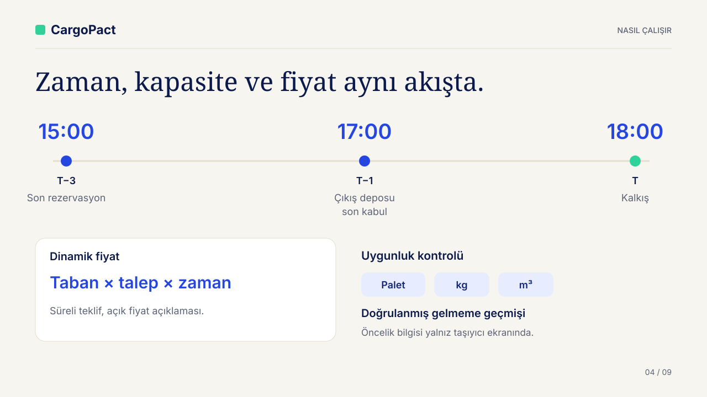
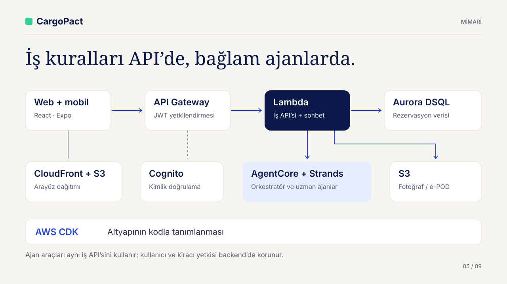
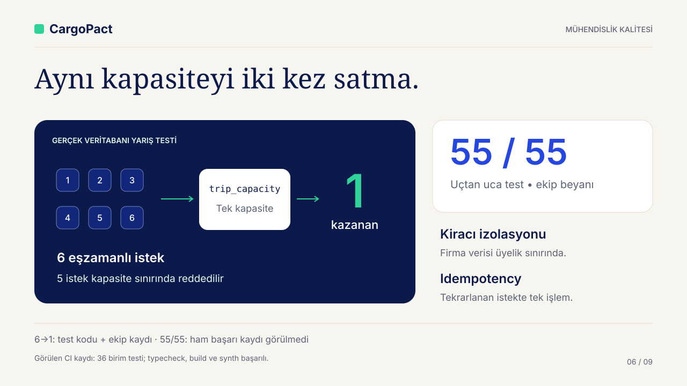
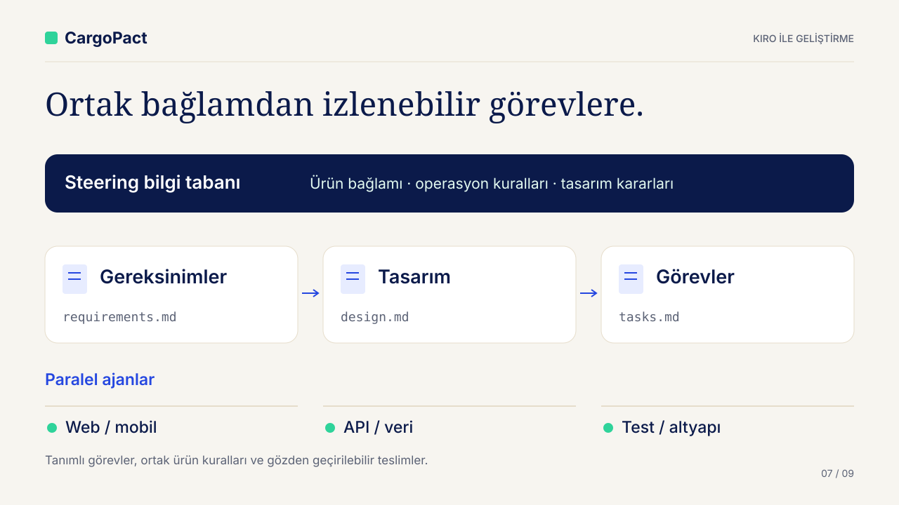
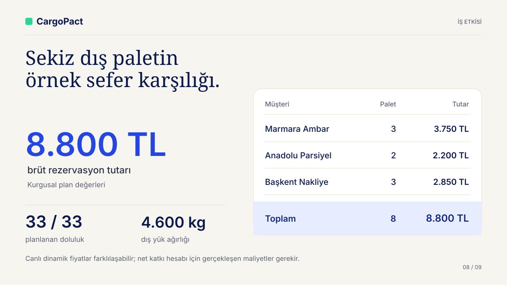
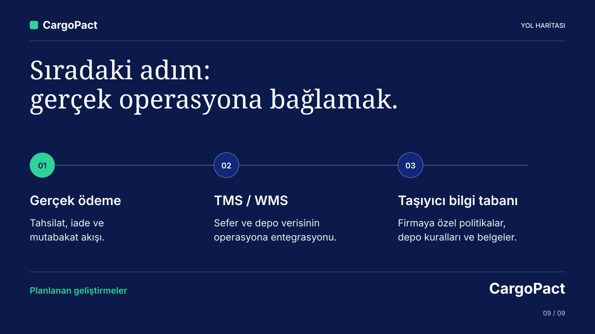

# CargoPact — 9 slaytlık sunum

**Modern + Premium · 16:9 · Türkçe**

[Sunum dosyası](cargopact-9-slides.html) · [Konuşmacı notları JSON](speaker-notes.json) · [Tasarım belirteçleri](../design-handoff/tokens.json)

HTML dosyasını indirip tarayıcıda aç: önceki/sonraki, klavye gezinmesi, konuşmacı notları ve PDF için yazdırma görünümü vardır. Fontlar Google Fonts üzerinden yüklenir; çevrimdışı serif/sans yedekleri kullanılır. Aşağıdaki SVG görselleri GitHub’da doğrudan incelenebilir.

Sunum, kaynaklarda tanımlanan mimariyi ve kurgusal demo senaryosunu anlatır. 55/55 E2E ekip beyanıdır; ham başarı çıktısı görülmedi. Gerçek DSQL 6→1 sonucu test kodu ve ekip ilerleme kaydıyla desteklenir; bu çalışmada canlı AWS testleri yeniden çalıştırılmadı.

## 1. Problem

**Konuşmacı notu:** Bu şema, 33 pozisyonlu bir araçta 25 iç palet bulunan kurgusal demo seferini gösteriyor. CargoPact’in hedefi, kalan sekiz pozisyonu taşıyıcının operasyon sınırları içinde müşterilere görünür ve rezervasyon yapılabilir hale getirmek.

**Kaynaklar:**

- [Kaynak 1](https://github.com/enescevik/cargopact/blob/b90cb6f13439fe5d9783149e78db9a601229ae81/docs/PRESENTATION.md)

## 2. Çözüm

**Konuşmacı notu:** Taşıyıcı satışa açacağı palet, ağırlık ve hacim sınırlarını belirler; müşteri uygun seferde rezervasyon oluşturur. Müşteri yükünü çıkış deposuna getirir, varışta kendisi veya yetkili alıcısı depodan teslim alır; kapıdan alım ve kapıya teslim bu akışın kapsamında değildir.

**Kaynaklar:**

- [Kaynak 1](https://github.com/enescevik/cargopact/blob/b90cb6f13439fe5d9783149e78db9a601229ae81/docs/PRESENTATION.md)

## 3. Canlı demo akışı

**Konuşmacı notu:** Marmara’nın üç, Anadolu’nun iki paletiyle planlanan doluluk 30’a çıkar; Başkent’in ilk talebi dış yükü 5.300 kilograma çıkaracağı için reddedilir. Başkent talebini 1.900 kilograma revize ettiğinde toplam dış yük 4.600 kilogram olur ve araç 33 planlanan palete ulaşır.

**Kaynaklar:**

- [Kaynak 1](https://github.com/enescevik/cargopact/blob/b90cb6f13439fe5d9783149e78db9a601229ae81/scripts/smoke-demo.mjs)
- [Kaynak 2](https://github.com/enescevik/cargopact/blob/b90cb6f13439fe5d9783149e78db9a601229ae81/docs/PRESENTATION.md)

## 4. Nasıl çalışır

**Konuşmacı notu:** Bu örnekte rezervasyon 15.00’te, çıkış deposu kabulü 17.00’de kapanır ve araç 18.00’de hareket eder; uygunluk palet, kilogram ve metreküp açısından birlikte kontrol edilir. Fiyat taban, talep ve zaman katsayılarıyla oluşur; doğrulanmış gelmeme geçmişi taşıyıcının öncelik değerlendirmesinde kullanılır ve müşteri ekranına açılmaz.

**Kaynaklar:**

- [Kaynak 1](https://github.com/enescevik/cargopact/blob/b90cb6f13439fe5d9783149e78db9a601229ae81/docs/PRESENTATION.md)

## 5. Mimari

**Konuşmacı notu:** Mimari görünüm, repodaki CDK ve ajan kaynaklarından arayüz, kimlik, iş akışı, veri ve ajan sorumluluklarını özetliyor. Cognito, API Gateway, Lambda ve Aurora DSQL temel işlem akışını; S3 ve CloudFront arayüz ile belge katmanını; AgentCore ve Strands ajan iş akışını oluşturuyor, ancak canlı AWS çalıştırması bu sunum çalışmasında yeniden doğrulanmadı.

**Kaynaklar:**

- [Kaynak 1](https://github.com/enescevik/cargopact/blob/b90cb6f13439fe5d9783149e78db9a601229ae81/docs/ARCHITECTURE.md)
- [Kaynak 2](https://github.com/enescevik/cargopact/blob/b90cb6f13439fe5d9783149e78db9a601229ae81/infra/lib/agents-stack.ts)
- [Kaynak 3](https://github.com/enescevik/cargopact/blob/b90cb6f13439fe5d9783149e78db9a601229ae81/agents/src/cargopact_agents/orchestrator.py)

## 6. Mühendislik kalitesi

**Konuşmacı notu:** DSQL test kodu altı eşzamanlı istekte bir kazananı ve beş kapasite reddini doğruluyor; PROGRESS kaydı bu grubun 4/4 geçtiğini bildiriyor. 55/55 uçtan uca başarı ekip beyanı olarak gösteriliyor; ilgili smoke betiği bulundu, ancak ham başarı kaydı görülmedi ve canlı testler bu çalışmada yeniden çalıştırılmadı.

**Kaynaklar:**

- [Kaynak 1](https://github.com/enescevik/cargopact/blob/b90cb6f13439fe5d9783149e78db9a601229ae81/packages/db/src/dsql.integration.test.ts)
- [Kaynak 2](https://github.com/enescevik/cargopact/blob/b90cb6f13439fe5d9783149e78db9a601229ae81/docs/PROGRESS.md)
- [Kaynak 3](https://github.com/enescevik/cargopact/blob/b90cb6f13439fe5d9783149e78db9a601229ae81/scripts/smoke-demo.mjs)
- [Kaynak 4](https://github.com/enescevik/cargopact/actions/runs/45599933450/job/139155857895)

## 7. Kiro ile geliştirme

**Konuşmacı notu:** Repoda steering bilgi tabanı ve yedi spec klasörü bulunuyor; gereksinim, tasarım ve görev belgeleri ürün kurallarını teknik uygulamaya bağlıyor. Paralel ajan kullanımı ekibin geliştirme kaydında anlatılıyor; bu süreç tamamlanmış işlerin ve açık görevlerin durumuyla birlikte izleniyor.

**Kaynaklar:**

- [Kaynak 1](https://github.com/enescevik/cargopact/tree/b90cb6f13439fe5d9783149e78db9a601229ae81/.kiro)
- [Kaynak 2](https://github.com/enescevik/cargopact/blob/b90cb6f13439fe5d9783149e78db9a601229ae81/docs/PRESENTATION.md)
- [Kaynak 3](https://github.com/enescevik/cargopact/blob/b90cb6f13439fe5d9783149e78db9a601229ae81/docs/PROGRESS.md)

## 8. İş etkisi

**Konuşmacı notu:** Marmara, Anadolu ve Başkent rezervasyonlarının örnek tutarları toplam 8.800 TL brüt rezervasyon tutarı oluşturuyor ve planlanan doluluk 25’ten 33 palete çıkıyor. Tutarlar kurgusal plan değerleridir; canlı dinamik fiyatlar farklılaşabilir ve net katkı hesabı için gerçekleşen maliyetler gerekir.

**Kaynaklar:**

- [Kaynak 1](https://github.com/enescevik/cargopact/blob/b90cb6f13439fe5d9783149e78db9a601229ae81/docs/PRESENTATION.md)

## 9. Yol haritası

**Konuşmacı notu:** Bir sonraki kapsam, gerçek ödeme sağlayıcısıyla para akışını, TMS ve WMS entegrasyonlarıyla operasyon verisini birleştirmek. Taşıyıcıya özel bilgi tabanı da ajanın firma politikaları ve depo kurallarıyla çalışmasını sağlayacak; bu başlıklar henüz tarih veya teslim taahhüdü içermiyor.

**Kaynaklar:**

- [Kaynak 1](https://github.com/enescevik/cargopact/blob/b90cb6f13439fe5d9783149e78db9a601229ae81/docs/PRESENTATION.md)

## Üretim ve doğrulama

- Tam 9 slayt; her SVG 1280 × 720 (16:9).
- Görseller metin ve vektör öğeleri olarak düzenlenebilir; her slaytta erişilebilir başlık ve açıklama vardır.
- Demo aritmetiği kontrol edildi: 25+3+2+3=33; ret 5.300>5.000 kg; revize toplam 4.600 kg; brüt örnek tutar 8.800 TL.
- Sayfa adedi, SVG çerçevesi, kaynak bağlantıları, notlar ve gezinme kodu yapısal olarak kontrol edildi.
- Çalışma ortamı bağlantısı kesildiği için son tarayıcı görüntüsü ve PowerPoint/PDF dışa aktarımı doğrulanamadı. Bu pakette PPTX veya üretilmiş PDF dosyası bulunduğu iddia edilmez.

